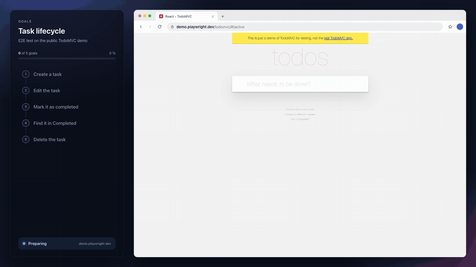

# ardia-recorder

[English](README.md)

Skill para agentes que graba en video un recorrido hecho con [Ardia](https://ardia.dev) (`ardia browse`) y lo exporta como MP4 de 1920 × 1080. Un panel lateral muestra los objetivos del encargo, cuál está en curso, cuáles se cumplieron y cuánto tardó cada uno. La página se ve dentro de una ventana con el estilo de Ardia (pestañas verticales y el dominio real en la barra de direcciones), y un puntero virtual marca cada elemento antes de actuar sobre él.

Sirve para dejar evidencia de pruebas e2e y para mostrar paso a paso cómo se cumple una tarea en una web.

[](assets/demo.mp4)

Video completo: [assets/demo.mp4](assets/demo.mp4) (38 s, 1920 × 1080).

## Instalación

Con [APM](https://microsoft.github.io/apm/):

```sh
apm install --global skapxd/ardia-recorder
```

Para fijar una versión, añade el tag: `skapxd/ardia-recorder#v1.2.0`. Para elegir el agente de destino, añade `--target claude`, `--target codex` u otro de los que admite APM.

### Verificar la procedencia

Cada release incluye `ardia-recorder-<versión>.tar.gz`, generado por GitHub Actions a partir del tag, con una atestación de procedencia firmada (SLSA, Sigstore). Para comprobarla e instalar desde ese paquete:

```sh
gh release download v1.2.0 -R skapxd/ardia-recorder -p 'ardia-recorder-*.tar.gz'
gh attestation verify ardia-recorder-v1.2.0.tar.gz -R skapxd/ardia-recorder
tar -xzf ardia-recorder-v1.2.0.tar.gz
apm install --global "$PWD/ardia-recorder"
```

## Requisitos

- macOS con Ardia abierto y **Settings → Advanced → Command line and automation → Let programs control Ardia** activado.
- Python 3, FFmpeg con `libx264` y Google Chrome.

Opcional: con permiso de grabación de pantalla para la terminal y las herramientas de línea de comandos de Xcode (`swiftc`), la ventana se graba de forma fluida; sin ellos, la página se captura con screenshots. Probada con la app Ardia 0.2.48 y la CLI `ardia` 0.6.0.

## Uso

Pídele al agente algo como *«graba en video cómo se crea y se borra una tarea en esta web, con los objetivos a la izquierda»*. La skill le indica cómo convertir el pedido en objetivos, escribir el escenario, probarlo sin grabar, grabarlo, exportarlo y revisar el resultado.

Un escenario es un archivo Python corto:

```python
from recorder import Recording

OBJETIVOS = [
    ('Crear una tarea', 'Escribir el texto y confirmarlo con Enter'),
    ('Borrar la tarea', 'Quitarla de la lista con la ✕'),
]

with Recording('Ciclo de una tarea', 'Prueba e2e de TodoMVC', OBJETIVOS,
               'https://demo.playwright.dev/todomvc/#/active', lang='es') as r:
    with r.goal(0):
        r.point('.new-todo', 'Escribir una tarea nueva')
        r.act('type', r.ref('textbox'), 'Comprar pan')
        r.act('press', 'Enter')
        r.check('Comprar pan' in r.cli('get', 'text', '.todo-list'), 'La tarea no se creó')
    ...
```

Con `lang='es'`, los textos propios del panel salen en español.

- La API y los ajustes de encuadre están en [references/framework.es.md](references/framework.es.md).
- Encargos completos de ejemplo, en inglés: [examples/todomvc/](examples/todomvc/) (una pestaña) y [examples/todomvc-tabs/](examples/todomvc-tabs/) (dos pestañas, con `r.tab()`).

## Estructura

| Ruta | Contenido |
|---|---|
| `SKILL.md` | Instrucciones para el agente (en español: `SKILL.es.md`) |
| `scripts/` | Grabación (`recorder.py`), marcas en la página (`overlay.js`), marco (`frame.html`) y exportación (`render.py`) |
| `references/` | API del escenario, ajustes y revisión (`framework.md`, `framework.es.md`) |
| `examples/` | Encargos y escenarios de ejemplo: una pestaña y dos pestañas |

## Licencia

MIT
