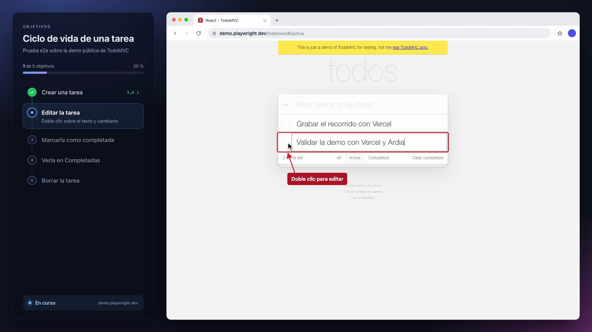

# ardia-recorder

Skill para agentes que graba en video un recorrido hecho con [Ardia](https://ardia.dev) (`ardia browse`) y lo exporta como MP4 de 1920 × 1080. Un panel lateral muestra los objetivos del encargo, cuál está en curso, cuáles se cumplieron y cuánto tardó cada uno. La página se ve dentro de una ventana de navegador con su URL real, y cada elemento se marca antes de actuar sobre él.

Sirve para dejar evidencia de pruebas e2e y para mostrar paso a paso cómo se cumple una tarea en una web.



## Instalación

Con [APM](https://microsoft.github.io/apm/):

```sh
apm install --global skapxd/ardia-recorder
```

Para fijar una versión, añade el tag: `skapxd/ardia-recorder#v1.0.0`. Para elegir el agente de destino, añade `--target claude`, `--target codex` u otro de los que admite APM.

### Verificar la procedencia

Cada release incluye `ardia-recorder-<versión>.tar.gz`, generado por GitHub Actions a partir del tag, con una atestación de procedencia firmada (SLSA, Sigstore). Para comprobarla e instalar desde ese paquete:

```sh
gh release download v1.0.1 -R skapxd/ardia-recorder -p 'ardia-recorder-*.tar.gz'
gh attestation verify ardia-recorder-v1.0.1.tar.gz -R skapxd/ardia-recorder
tar -xzf ardia-recorder-v1.0.1.tar.gz
apm install --global "$PWD/ardia-recorder"
```

## Requisitos

- macOS con Ardia abierto y **Settings → Advanced → Command line and automation → Let programs control Ardia** activado.
- Permiso de grabación de pantalla para la terminal que ejecuta la grabación.
- Python 3, FFmpeg con `libx264` y Google Chrome.

## Uso

Pídele al agente algo como *«graba en video cómo se crea y se borra una tarea en esta web, con los objetivos a la izquierda»*. La skill le indica cómo convertir el pedido en objetivos, escribir el escenario, probarlo sin grabar, grabarlo, exportarlo y revisar el resultado.

Un escenario es un archivo Python corto:

```python
from ardia_video import Grabacion

OBJETIVOS = [
    ('Crear una tarea', 'Escribir el texto y confirmarlo con Enter'),
    ('Borrar la tarea', 'Quitarla de la lista con la ✕'),
]

with Grabacion('Ciclo de una tarea', 'Prueba e2e de TodoMVC', OBJETIVOS,
               'https://demo.playwright.dev/todomvc/#/active') as g:
    with g.objetivo(0):
        g.guiar('.new-todo', 'Escribir una tarea nueva')
        g.accion('type', g.ref('textbox'), 'Comprar pan')
        g.accion('press', 'Enter')
        g.comprobar('Comprar pan' in g.cli('get', 'text', '.todo-list'), 'La tarea no se creó')
    ...
```

- La API y los ajustes de encuadre están en [references/framework.md](references/framework.md).
- Hay un encargo completo de ejemplo en [examples/todomvc/](examples/todomvc/).

## Estructura

| Ruta | Contenido |
|---|---|
| `SKILL.md` | Instrucciones para el agente |
| `scripts/` | Grabación (`ardia_video.py`), capa visual (`guia-visual-ardia.js`), marco (`marco.html`) y exportación (`renderizar.py`) |
| `references/framework.md` | API del escenario, ajustes y revisión |
| `examples/todomvc/` | Encargo y escenario de ejemplo |

## Licencia

MIT
